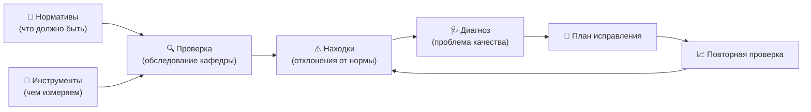

# Концепция: «Канон» (Қонун · QANUN) — диагностика здоровья образования ТГМУ

Название утверждено владельцем 14.10.2026: в честь «Канона врачебной науки» Абуали ибни Сино.

Черновик для обсуждения (версия 2). Всё, что помечено «предположение», нужно подтвердить.

## 1. Главная идея: образование как организм

Программа устроена по образцу медицины. Отдел стратегического развития и качества обучения — **диагност**.

| Медицина | В программе | Пример |
|---|---|---|
| Организм | Университет и его части | ТГМУ → факультет → кафедра → программа → дисциплина → преподаватель |
| Системы органов | Области оценки | Программа обучения, процесс, методы обучения, методы оценки, кадры, ресурсы… |
| Норма, референсные значения | **Нормативы** (стандарты → критерии → показатели) | «Доля преподавателей с учёной степенью ≥ 50 %» |
| Методы обследования | **Инструменты** | Чек-лист проверки, анкета студентов, протокол посещения занятия |
| Обследование | **Проверка** (применение инструментов к кафедре) | Плановая проверка кафедры терапии, март 2027 |
| Отклонение от нормы | **Находка** | Показатель 38 % при норме ≥ 50 % |
| Нозология, диагноз | **Проблема качества** из справочника (с тяжестью) | «Кадровый дефицит, средняя тяжесть» |
| Лечение по протоколу | **План исправления** (мероприятия, ответственный, срок) | «Принять 2 к.м.н. до сентября» |
| Наблюдение в динамике | **Повторная проверка**, история | Было 38 % → стало 52 % |
| Медицинская карта | **Паспорт подразделения** | Все проверки, диагнозы и лечение кафедры за годы |

## 2. Три слоя хранятся отдельно

Я понял ваше сравнение с рецептом так: **что должно быть**, **чем это измеряют** и **само действие**
хранятся отдельно и связываются между собой.

1. **Нормативы («рецепт»)** говорят, каким должно быть образование. В программе это справочник.
2. **Инструменты («кухонная утварь»)** — это чек-листы, анкеты и протоколы, которыми проверяют норму.
   Один инструмент может проверять много норм, а одну норму могут проверять несколько инструментов.
3. **Действия («готовка»)**: проверки, диагнозы, планы исправления. Это ежедневная работа отдела.

Если поменять норматив (например, вышла новая редакция стандарта), инструменты и старые проверки
не ломаются. История остаётся, и видно, по какой версии нормы проверяли тогда.

### 2.1. Нормативы

Строение: **документ-источник → область → стандарт → критерий → показатель**.

- Документы-источники (предложение, список можно менять):
  - **WFME** — мировые стандарты базового медицинского образования (редакция 2020 года, 8 областей:
    миссия и ценности, образовательная программа, оценка студентов, студенты, академический штат,
    образовательные ресурсы, обеспечение качества, управление и администрирование);
  - **ESG** — европейские стандарты обеспечения качества высшего образования;
  - **ISO 21001:2018** — международный стандарт системы менеджмента образовательной организации.
    Из него берём «скелет» работы отдела: цикл «планируй → делай → проверяй → улучшай»,
    внутренний аудит, анализ со стороны руководства, несоответствия и корректирующие действия,
    удовлетворённость обучающихся. Это и есть наш цикл «проверка → диагноз → лечение → повторная проверка»;
  - **AMEE** — международная ассоциация медицинского образования. Её методические руководства
    (AMEE Guides) дают «методы обследования»: как оценивать студентов (ОСКЭ, оценка на рабочем месте,
    пирамида Миллера), как оценивать сами программы (модель Киркпатрика). Программа признания ASPIRE
    служит ориентиром **высокого** уровня;
  - **IAAR** (Независимое агентство аккредитации и рейтинга): по нему ТГМУ проходил институциональную и
    программную аккредитацию; «Общая медицина» — до 2027 г. (по выдаче поиска, см. [`САЙТ_ТГМУ.md`](САЙТ_ТГМУ.md));
  - национальные требования Республики Таджикистан к аккредитации и лицензированию;
  - внутренние положения ТГМУ.
- У каждого показателя есть: как измеряется, единица, источник (пункт документа), какой инструмент его
  проверяет и **три уровня нормы**.

### 2.2. Уровни строгости: слабый, средний, высокий

Это как разные референсные значения у анализа.

| Уровень | Смысл (утверждено владельцем 14.10.2026) | Пример порога |
|---|---|---|
| Слабый (базовый) | Минимум по национальным требованиям | ≥ 40 % |
| Средний | Базовые стандарты WFME («обязательно») | ≥ 50 % |
| Высокий | Стандарты развития качества WFME («желательно»), ориентиры AMEE ASPIRE, ISO 21001 | ≥ 65 % |

- Уровень выбирают на весь университет, а для отдельной кафедры или программы можно поставить свой.
  Например, кафедру, которая готовится к международной аккредитации, проверяют по высокому уровню.
- Пороги, формулировки и сами уровни отдел меняет мышкой, без программиста. Каждое изменение
  сохраняется как новая версия: кто, когда и что поменял.
- Набор «стандарты + уровни» можно сохранить как **профиль**: «Национальная аккредитация»,
  «Подготовка к WFME» и т. п.

### 2.3. Инструменты (методы обследования)

Библиотека, которую можно дополнять:

| Вид инструмента | Что проверяет |
|---|---|
| Чек-лист проверки документов | Рабочие программы, силлабусы, фонды оценочных средств |
| Протокол посещения занятия | Методы обучения, вовлечённость студентов |
| Анкета (студенты, выпускники, работодатели, преподаватели) | Удовлетворённость, обратная связь |
| Сбор показателей (форма или загрузка Excel) | Кадры, успеваемость, отсев, публикации |
| Анализ экзамена | Качество тестов: трудность, различающая способность заданий |
| Интервью или фокус-группа | Качественные данные, протокол со ссылкой на нормы |

У каждого пункта инструмента указано, какой показатель он измеряет. Поэтому результаты сами
«ложатся» на нормы.

### 2.4. Диагнозы: справочник проблем качества

Это свой «классификатор болезней образования». Для каждой проблемы указано:
- название и код;
- по каким находкам её ставят: «если показатели А и Б ниже нормы → подозрение на проблему X»;
- тяжесть: лёгкая, средняя, тяжёлая;
- **типовое лечение**: рекомендуемые мероприятия и обычные сроки (как клинический протокол).

Программа **предлагает** диагноз, а **ставит его эксперт отдела**. Окончательное решение всегда
за человеком. Примеры проблем: «устаревшая рабочая программа», «оценка не соответствует целям
обучения», «низкая удовлетворённость студентов», «высокий отсев», «перегрузка преподавателей».

## 3. Как это видно на экране

- **Карта здоровья кафедры.** «Паутинка» по областям оценки: где норма, где отклонение. Светофор
  зелёный, жёлтый, красный.
- **Тепловая карта университета.** Строки — кафедры, столбцы — области. Сразу видно, где «болит».
- **Паспорт подразделения.** Лента событий: проверки → диагнозы → лечение → результат.
- **Динамика.** Графики показателей по годам: помогает ли «лечение».
- **Панель руководства.** Несколько главных чисел, самые проблемные места и просроченные планы исправления.

## 4. Пользователи и права доступа

Роли закладываются с самого начала, даже если сначала в программе работает только отдел.

| Роль | Видит | Может |
|---|---|---|
| Администратор системы | Всё | Учётные записи, роли, настройки |
| Ректор, проректоры | Весь университет (только чтение) | Утверждать профили стандартов и итоги |
| Директор или начальник отдела | Весь университет | Менять нормативы, инструменты и справочник диагнозов; назначать проверки |
| Эксперт отдела | Назначенные ему проверки | Проводить проверки, ставить диагнозы, вести лечение |
| Декан | Свой факультет | Смотреть, комментировать, контролировать планы |
| Заведующий кафедрой | Свою кафедру | Вносить данные, самооценку, выполнять план исправления |
| Преподаватель | Свои данные и обобщённые отзывы о себе | Заполнять личный отчёт и самооценку |
| Студент | Только окно обратной связи | Анонимно отвечать на анкеты, писать отзыв или жалобу |
| Внешний эксперт или работодатель | Анкету или задание по ссылке | Отвечать, проводить внешнюю оценку |

**Регистрация.**
- Сотрудники регистрируются сами, а доступ им открывает администратор: он выбирает роль и подразделение.
- Студенты в отдельном окне заходят по QR-коду или ссылке группы, без имени. Анонимность защищена:
  итоги показываются, только если ответили не меньше, например, 5 человек.
- Права настраиваются таблицей, без программиста.

## 5. Порядок работ

| Этап | Что делаем | Как проверим, что готово |
|---|---|---|
| 0 | Собираем документы: национальные требования, положения ТГМУ, текущие анкеты и чек-листы, список кафедр | Список документов и структура университета внесены |
| 1 | Каркас: вход, роли, структура университета, **справочник нормативов** с уровнями и версиями | Отдел сам добавляет стандарт и меняет порог |
| 2 | **Библиотека инструментов** и связь «пункт инструмента → показатель» | Чек-лист создан, и видно, какие нормы он проверяет |
| 3 | **Проверки**: назначение, заполнение, автоматические находки, карта здоровья кафедры | Пробная проверка одной кафедры дала «паутинку» |
| 4 | **Диагнозы и лечение**: справочник проблем, план исправления, сроки, напоминания | Просроченное мероприятие видно на панели |
| 5 | **Окно обратной связи студентов** и анкеты | Группа по QR ответила, итог виден по кафедре |
| 6 | Панели ректора и декана, тепловая карта, отчёты в Word, Excel и PDF | Годовой отчёт формируется по кнопке |

## 6. Техника (предложение)

- Сайт в браузере (компьютер и телефон). Фронтенд Vite + JavaScript (как в МирМед), бэкенд **Django** (Python),
  база PostgreSQL. Модель данных — [`МОДЕЛЬ_ДАННЫХ.md`](МОДЕЛЬ_ДАННЫХ.md).
- Готовые открытые части (подробно — [`ИССЛЕДОВАНИЕ_GITHUB.md`](ИССЛЕДОВАНИЕ_GITHUB.md)): анкеты и чек-листы —
  SurveyJS, права по ролям — pycasbin, анализ экзаменов — girth, панели — Apache Superset; образцы процессов —
  EvaP (анонимная оценка курсов) и модули ISO-менеджмента OCA (CAPA). Ядро «норма → проверка → диагноз → лечение»
  готовым не существует — делаем своё.
- Справочник норм — с версиями: ESG сейчас пересматривается (ESG 2027), у WFME в 2020 г. вместо 9 областей стало 8.
- Языки интерфейса: русский и таджикский, английский — для международных экспертов.
- Тексты стандартов WFME, ESG, ISO 21001 и руководств AMEE защищены авторским правом (ISO — платный). В программе храним ссылку на пункт и
  своё краткое изложение, а полный текст отдел загружает сам из официального документа.
- Персональные данные хранятся на сервере, который выберет владелец (университет или VPS). Ответы
  студентов не связываются с их личностью.

## 7. Вопросы к владельцу

1. Какие национальные документы (приказы, требования к аккредитации) обязательны? Пришлите файлы или названия.
2. Подходят ли 8 областей WFME как основа «систем органов» или у ТГМУ своя структура?
3. ~~Смысл уровней~~ — утверждён 14.10.2026: слабый = национальный минимум, средний = базовый WFME, высокий = развитие качества WFME, AMEE, ISO 21001.
4. Есть ли уже анкеты и чек-листы, которыми отдел пользуется? Их внесём первыми инструментами.
5. Список факультетов и кафедр (можно таблицей).
6. Нужен ли таджикский язык с первого этапа?
